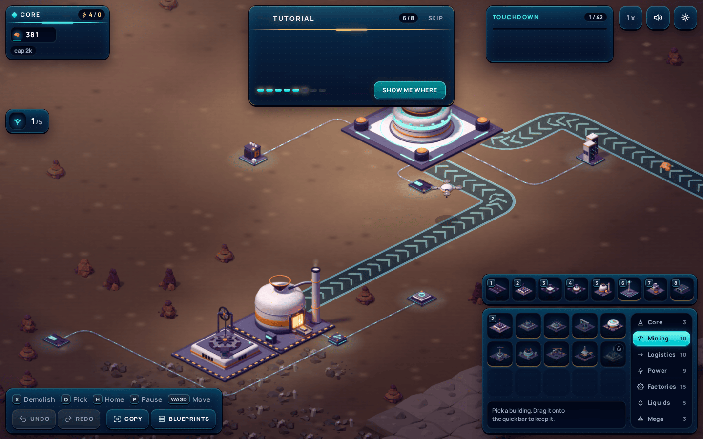
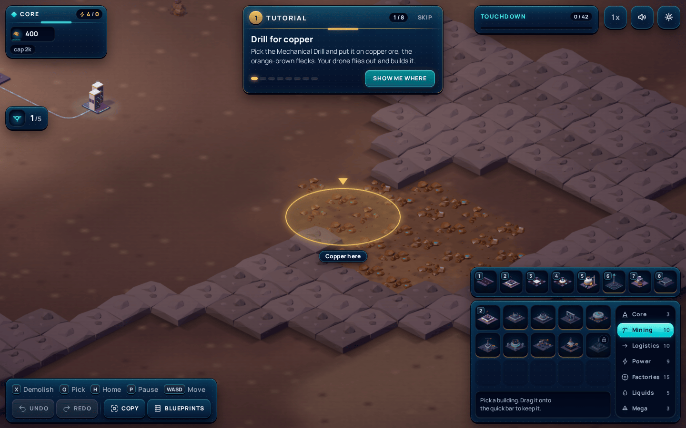
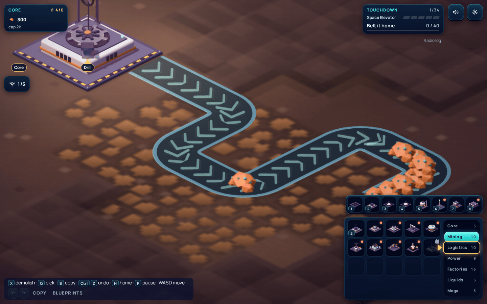
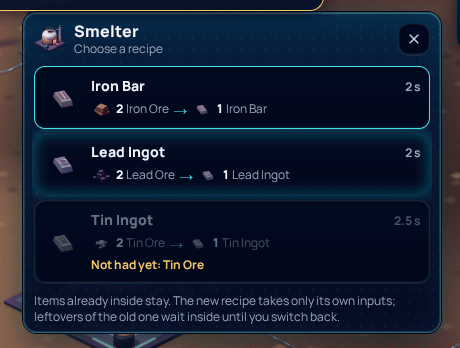
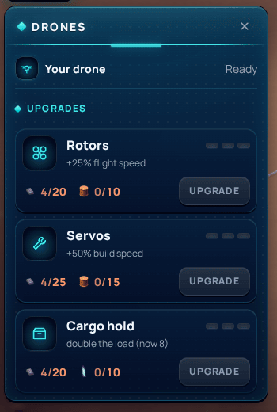
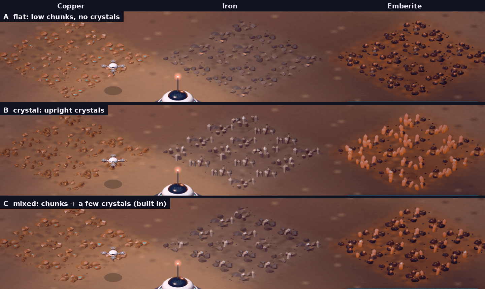

# Tetherline

A factory builder in the style of Mindustry, for the browser. Drill ore, lay belts, smelt and craft, run power
and pipes, and raise a Space Elevator, all in a one-hour "Quick Round". There are no enemies and no fail state.
Runs are saved on your device, with no account, backend or telemetry.

[Play in the browser](https://tetherline.pixel-cursor.com)

You land on a small stretch of alien ground with a core, a few resources and one build drone. Drills dig ore,
belts carry it, smelters and factories turn it into bars, alloys and parts, and a chain of orders walks you from
the first copper drill to the Space Elevator. You never place a building directly: every building is a ghost that
your drone welds up piece by piece.

Tetherline is inspired by Mindustry. It copies how belts and logistics behave, not any code or assets.

## Features

- **Quick Round:** one click starts a round of about an hour on a random seed. Customize picks the map size
  (small, medium, large), the world (Rust Desert, Green Meadow, Ice & Snow) and the seed.
- **57 buildings, 38 materials, 6 liquids, 42 recipes:** drills, conveyors, junctions, routers, sorters, bridges,
  unloaders and mass drivers; smelters and factories; power from the core, coal, solar, wind and oil, with
  batteries and power nodes; conduits and pumps; and the mega machines up to the Space Elevator.
- **42 orders** in chapters, each with a short radio line, lead through the whole tech tree and end in a victory
  moment. After it you can keep building or start a new round.
- **Guided first round:** an eight-step tutorial with a card, a glowing ring on the map and "Show me where". If a
  belt cannot work, it tells you why.
- **Drone building:** ghosts, holographic construction, belts that grow along your line, blueprints, area
  demolish, undo and redo, and a hotbar.
- **Procedural maps:** organic landmasses with lakes, oil, slag, rock ridges and wrecks that unlock blueprints.
  Every map is winnable: it always holds the ores the order chain needs.
- **Autopilot:** a bot plays the round with the same commands a player uses. Combined with game speeds up to 10x
  it also serves as the balance test.
- **Meta tree:** orders and victories pay "Blueprints", which buy head starts and unlock buildings.
- **Look and sound:** the buildings, ores, units and icons are low-poly 3D models built in code, rendered offline and drawn in 2D, in three
  camera views (oblique, steep and top-down). Music, effects and machine ambience are synthesized live with WebAudio.
  No external image, model or audio assets are used. A short rendered clip is in [docs/audio/](docs/audio/soundtrack.ogg).
- **Performance:** a stress scene of 3,000 buildings and 10,000 items on belts stays above 60 fps on a mid-range
  desktop GPU; the autopilot plans in a web worker, so the game does not stutter while it thinks.

## Screenshots

| | |
|---|---|
|  |  |
| The tutorial asks for a drill on copper ore. | Belts bend, merge and carry visible items. |
|  |  |
| Factories with several recipes get a setting panel. | The drone panel with its upgrades. |

The ore field styles that were compared; the mixed style (C) is the one in the game.

## Playing

Mouse and keyboard come first; touch controls are still basic. The Settings window (gear, top right) holds the
camera view, game speed, autopilot, volumes, decoration and lighting.

| Input | What it does |
| --- | --- |
| Click | Place the selected building as a ghost. With no tool: select, or salvage a wreck |
| Drag | Draw a belt or pipe line, a row of poles or buildings. With no tool: pan the map |
| Shift + drag | Fill a rectangle with the selected building |
| Ctrl while dragging | Bend a belt line the other way round |
| Right click | Put the tool away. With no tool: remove what is under the pointer |
| 1-9, 0 | Hotbar slot (drag buildings from the palette onto the slots) |
| R / Shift+R | Rotate (with no tool: the building under the pointer) |
| Q | Pipette: take the building under the pointer, with its setting |
| X | Demolish tool: drag a rectangle |
| Delete / Backspace | Remove what is under the pointer, decoration included |
| B or Ctrl+C | Copy an area as a blueprint; Ctrl+V pastes it, F mirrors it |
| Ctrl+Z / Ctrl+Y | Undo / redo |
| Esc | Put the tool away |
| WASD or arrows, wheel | Move the camera, zoom |
| H or Home | Camera back to the core |
| P or Space | Pause (building still works while paused) |
| . and , | Faster and slower game speed (1x, 2x, 3x, 5x, 10x) |

URL options, mainly for testing: `?seed=abc&size=l&theme=ice` starts a fresh round, `?slot=2` opens a save slot,
`?view=iso|steep|top` sets the camera view for one load, `?zoom=0.2` sets the start zoom, and `?dev` shows the
developer hooks (`?dev&manual` for a virtual clock, `?dev&stress=3000,10000` for the performance scene).

## Development

Node.js 24 or newer. Run `npm ci`. The scripts that drive a browser (`shots`, `smoke`, `perf`, `art`, `listen`)
need Chromium once: `npx playwright install chromium`.

| Command | Purpose |
| --- | --- |
| `npm run dev` | Vite dev server with hot reload and the developer hooks |
| `npm run build` | Production build to `dist/` |
| `npm run preview` | Serve `dist/` on port 4317 |
| `npm run lint` | ESLint, zero warnings allowed, complexity at most 10 per function |
| `npm run typecheck` | TypeScript, strict, for the app and for the scripts |
| `npm run test:run` | Unit tests (Vitest): content validation, simulation, belts, saves, autopilot, art kit |
| `npm run test:bot` | Long test: the autopilot must win a round within 90 game minutes (2 to 4 real minutes) |
| `npm run bench` | Simulation cost per tick on a stress scene |
| `npm run autopilot` | Whole rounds played headless by the bot, with a log per minute |
| `npm run smoke` | Click through the real game in Chromium: menu, tutorial, belts, panels, all three views |
| `npm run shots` | Screenshots at phone, tablet and desktop sizes into `docs/screenshots/` |
| `npm run perf` | Frame times of the stress scene on a real GPU |
| `npm run art` | Render the 3D models into `public/art/` (see [docs/art.md](docs/art.md)) |
| `npm run artsheet` | Contact sheet of the SVG sprites |
| `npm run listen` | Render the audio offline and print its levels |

The game was first built under the codename Groundbreak. A few internal identifiers keep that name so that existing
saves and tools keep working: the IndexedDB database `groundbreak`, localStorage keys `groundbreak.*`, the events
`groundbreak:*` and the dev hook `window.groundbreak`.

## Structure

`src/content` holds the schema and all game data (buildings, materials, recipes, orders, themes), validated by
tests. `src/sim` is the deterministic simulation at a fixed 20 Hz and needs no DOM; `src/game` is the shell around it
(commands, interaction tools, autopilot). `src/render` draws it with PixiJS, `src/ui` is the React HUD, `src/audio`
synthesizes sound, and `src/save` keeps three IndexedDB slots. `art3d/` holds the 3D models that are rendered offline
into `public/art/`. `src/legacy` holds the content and SVG art of the game's first design, which the art kit still
reads.

More: [architecture](docs/architecture.md), [art pipeline](docs/art.md), [art direction](docs/art-direction.md),
[audio](docs/audio/README.md), [design decisions](docs/decisions.md), [roadmap](docs/ROADMAP.md) and
[notes for AI assistants](CLAUDE.md).

## License

MIT, see [LICENSE](LICENSE). All graphics and sounds are generated from code in this repository, see
[ASSETS.md](ASSETS.md).
